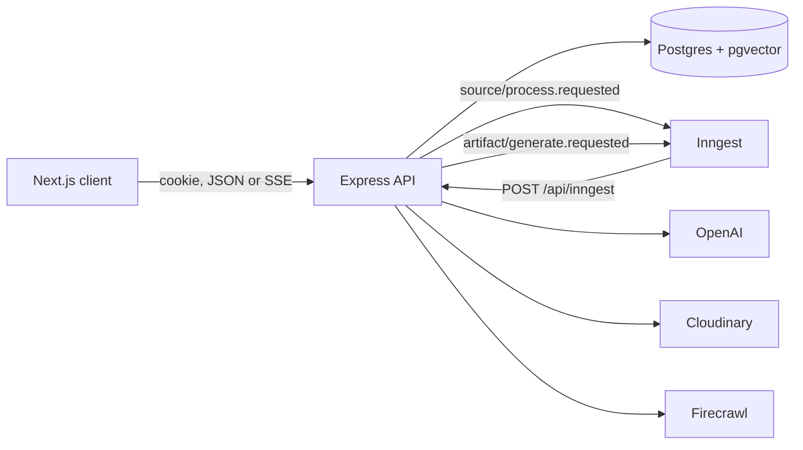

# Mosaic Research

A private study workspace. Import PDFs, websites, YouTube transcripts, and notes. Ask grounded questions with citations. Generate flashcards, quizzes, and reports from the sources you already own.

The browser talks only to an Express API. Postgres holds the documents, the chunks, and the vectors. Inngest runs the slow work after the HTTP response has already returned.

**Open source.** Docs: [`index.html`](./index.html). Star the repo: [github.com/SirSimon162/mosaic-book](https://github.com/SirSimon162/mosaic-book). Architecture detail is this README. The Next.js app starts at `/mosaic`; signed-out visitors get login/register.



## Process boundary

Three processes run locally. The API (`server/`, `tsx watch`) owns HTTP, Prisma, and the Inngest functions. The Inngest dev server queues events and calls back into `POST /api/inngest`. The Next.js app is a client of the API. It never opens Postgres.

That split is the main scaling decision. Uploading a PDF, scraping a page, embedding chunks, and writing a study summary are too slow to hold inside the request that created the row. The request inserts a `PENDING` row, sends one event, and returns. The browser learns progress by reading `status` later.

`/api/inngest` is unauthenticated on purpose. In production the Inngest SDK checks `INNGEST_SIGNING_KEY` on those calls. Locally `isDev` is true whenever `NODE_ENV` is not `production`, so events stay on the dev server. The event key and signing key are not required until the API talks to Inngest Cloud.

## Code layout

Server code is `route → service → repository`.

| Layer | Job |
|-------|-----|
| Route | Parse params and body with Zod, send the JSON envelope, attach rate limits |
| Service | Rules: membership, empty `sourceIds`, enqueue the event |
| Repository | Prisma queries and the raw SQL that writes vectors |
| `server/src/lib` | Cloudinary, PDF, Firecrawl, YouTube, chunking, OpenAI, query correction, Inngest client |
| `server/src/inngest` | `process-source`, `generate-artifact` |

A route does not embed text. A repository does not decide that an empty source list is invalid. That keeps the HTTP edge replaceable and the SQL in one place.

The success envelope is `{ success: true, result }`. Failure is `{ success: false, error }`. Auth is the `token` cookie: `httpOnly`, `sameSite: "lax"`, `secure` when `NODE_ENV` is `production`. The JWT is never handed to JavaScript. Passwords are Argon2id hashes.

CORS allows one browser origin, `CLIENT_ORIGIN`, with credentials. It defaults to `http://localhost:3000` so a local `.env` that predates this variable still boots.

## Authorization

A workspace has an owner and a member list. The owner is connected as a member at creation, so one membership check covers reads.

| Action | Rule |
|--------|------|
| Read a workspace, its sources, chats, and artifacts | Any member. A stranger gets `404`, so ids are not confirmed to exist |
| Rename, change `defaultModel`, delete | Owner only |
| Invite | Owner only. `POST /api/workspace/:workspaceId/invites` with `{ email }` returns a token that lasts 7 days |
| Accept | `POST /api/workspace/invites/accept` with `{ token }`. The signed-in user's email must match. The user is connected on `Workspace.users` |

There is no mailer. The token is the invite. A pending invite for the same email is returned again instead of minting a second one. This is enough to share a workspace. Sending the email, and expiring tokens with a sweeper, are later work.

## Data model

```
User
  └── owned workspaces, member workspaces

Workspace
  ├── defaultModel          gpt-4o-mini or gpt-4o
  ├── sources, chats, artifacts, invites

Source
  ├── source                full extracted text, in Postgres
  ├── status                PENDING → PROCESSING → COMPLETED or FAILED
  ├── error                 short final failure, cleared when processing restarts
  └── chunks                content, page metadata, embedding vector(1536)

Chat
  ├── summary               rolling memory of older turns
  └── messages              role, content, citations JSON

LearningArtifact
  ├── type                  SUMMARY, TAKEAWAYS, FLASHCARDS, QUIZ, MINDMAP, REPORT
  ├── content               JSON, null until the job finishes
  ├── sourceIds             snapshot of the sources used
  └── error

WorkspaceInvite
  └── email, token, expiresAt, acceptedAt
```

Chunks are their own table so a chat search never loads the whole document. The embedding column is `Unsupported("vector(1536)")` because Prisma cannot model pgvector. Inserts and search use parameterized raw SQL and cast with `::vector`. The HNSW cosine index is created at API boot, not in a Prisma migration. Prisma will sometimes call that index drift and offer to drop it. Do not reset the database for that warning.

`Source.error` and `LearningArtifact.error` are one line, capped at 300 characters. They are the message a person can read. The Inngest run trace keeps the stack.

## Ingest

`enqueueSourceProcessing` sends `source/process.requested` with `{ sourceId, workspaceId }` after every create, import, and reprocess. `process-source` is the only consumer. Nothing polls on a timer.

The function is a sequence of `step.run` checkpoints. If the embed step throws, Inngest runs the function again, returns the saved result of the steps that finished, and repeats the failed step. Each step's return value is posted back to this API on the next call, so a step returns a page count, a URL, or `{ count }`. The document stays on the `Source` row.

| Type | What the extract step writes | What it returns |
|------|------------------------------|-----------------|
| PDF | Joined text, plus a temporary `pages` array | `pageCount` |
| Website | Markdown and the final URL | `{ sourceUrl }` |
| YouTube | Transcript text, watch URL, video id | `{ sourceUrl, videoId }` |
| Text, Markdown | Already stored by the create request | No extract step |

The chunk step reads that text back from Postgres, splits it, embeds it, and replaces that source's chunks in one transaction. PDF chunks keep `metadata.page`. After the insert commits, `pages` is deleted. The full text remains in `Source.source`. The page list was only the handoff between extract and chunk. Leaving it would store the PDF twice and ship it again whenever the source row is loaded.

`replaceSourceChunks` deletes the old chunks and inserts the new ones inside a 60 second transaction. The delete rolls back if an insert fails. Embeddings are requested before that transaction opens, so a slow OpenAI call does not hold a database lock.

Settings on the function:

- **Retries: 3.** A normal throw uses Inngest's backoff: about 15 seconds, then 30, then 1 minute, plus up to 30 seconds of jitter. The attempt counter lives in Inngest, not in Postgres.
- **`NonRetriableError`.** Missing file, empty extract, missing captions, missing API key, or an OpenAI 4xx other than 429. Inngest skips the backoff and `onFailure` sets `FAILED` plus `error`.
- **Concurrency: one run per `sourceId`.** Two different documents can run together. The same document cannot, because both runs would be replacing its chunks.

`/api/inngest` accepts a JSON body up to 10 MB. That is a ceiling for Inngest's own step state. It is not the place the document is stored. Other routes keep the default body limit.

Chunking defaults live in `server/src/lib/ai-config.ts`: 1000 characters, 100 of overlap. Overlap exists so a sentence cut in half still appears whole in one of the two chunks.

## Retrieval and chat

Passage search and chat both call `searchWorkspaceSources`. After optional typo correction, Mosaic retrieves with **query + step-back + HyDE** embeddings, fuses the ranked lists with **RRF**, then answers only from real workspace chunks.

Search embeds text with `text-embedding-3-small` (1536 dimensions) and orders chunks by cosine distance in pgvector. The score is `1 - distance`. Rows worse than `RAG_MIN_SCORE` (0.5) are dropped per list. The query always joins `Source` and filters by `workspaceId`, so a chunk from another workspace cannot match. An explicit empty `sourceIds` list searches nothing and does not call the embedding API. Omitting the list searches every `COMPLETED` source in the workspace.

### HyDE (Hypothetical Document Embeddings)

Short questions live in a different embedding neighborhood than the passages stored in chunks. HyDE bridges that gap for **retrieval only**.

| Step | Behavior |
|------|----------|
| Draft | `gpt-4o-mini` writes a short reference-style passage that could answer the corrected query (`generateHypotheticalPassage`). |
| Embed | That passage is embedded alongside the corrected query (and step-back, below). |
| Search | Same pgvector search, same `RAG_MIN_SCORE`, same `workspaceId` filter. |
| Fallback | If HyDE fails or returns empty text, that list is skipped. |
| Answer path | The hypothetical passage is **never** returned as a citation, never stored on the message, and never injected into `streamFromSources`. |

Toggle and limits: `HYDE_ENABLED`, `HYDE_MODEL`, `HYDE_MAX_CHARS` in `ai-config.ts`.

**Not the same as step-back.** HyDE drafts an *answer-like passage*. Step-back drafts a *broader question*. Both are retrieval-only.

### Step-back prompting

Specific questions can miss the background chunk that actually holds the answer. Step-back asks a higher-level question first, then retrieves with that broader query as well.

| Step | Behavior |
|------|----------|
| Rewrite | `gpt-4o-mini` turns the corrected query into one broader question (`generateStepBackQuestion`), e.g. a role/context question instead of a narrow factual ask. |
| Embed | The step-back question is embedded as an extra retrieval query. |
| Skip | If rewrite fails, is empty, or equals the original query, that list is skipped. |
| Answer path | The step-back question is **never** cited and **never** added to the grounded chat prompt. |

Toggle and limits: `STEP_BACK_ENABLED`, `STEP_BACK_MODEL`, `STEP_BACK_MAX_CHARS` in `ai-config.ts`.

### Reciprocal Rank Fusion (RRF)

Query, step-back, and HyDE each produce their own ranked chunk list. Raw cosine scores are not comparable across those lists, so Mosaic fuses ranks instead of taking `max(score)`.

| Step | Behavior |
|------|----------|
| Input | Ranked lists already filtered by `RAG_MIN_SCORE` and workspace membership. |
| Score | For each chunk id: `Σ 1 / (RRF_K + rank)` across lists where it appears (`RRF_K = 60`). |
| Output | Sort by fused score, keep `RAG_TOP_K` (6). Payload kept from the strongest cosine hit for that chunk. |

Implementation: `server/src/lib/rrf.ts`, used by `searchWorkspaceSources`.

**Guardrails shared by HyDE, step-back, and RRF.** Generated text is only for embedding/ranking. Evidence still comes only from `SourceChunk` rows. Empty fused retrieval still yields `I couldn't find that in the sources for this workspace.` and skips the chat model. Score floor and workspace isolation are unchanged.

### Query typo correction

Before HyDE/query embedding, Mosaic optionally rewrites misspelled tokens against vocabulary that already exists in that workspace.

| Step | Behavior |
|------|----------|
| Vocab load | Up to 80 `COMPLETED` sources in the workspace (optional `sourceIds` filter). Uses each `title`, up to 120,000 characters of `Source.source`, plus a spread sample of chunk text (so names deep in long pages still count). |
| Tokenize | Alphanumeric tokens of length ≥ 3 (`QUERY_FUZZY_MIN_TOKEN`). |
| Exact hit | If the token already appears in the vocab (case-insensitive), leave it alone. |
| Fuzzy match | Otherwise score candidates with **Levenshtein** distance. Max distance is 1 for short tokens (length ≤ 4), otherwise up to `QUERY_FUZZY_MAX_DISTANCE` (2). Candidate length must be within that same window. |
| Neighbor preference | If the query already has an exact vocab token (e.g. `Jay`), prefer candidates that co-occur next to that token in sources. This is how `Jay sheh` becomes `Jay Shah` even when other distance-1 words exist. |
| Short-name support | Tokens of length 3 (e.g. `Vay`) only rewrite when that neighbor support exists. Longer tokens can still fall back to a unique global winner if no anchor helps. |
| Unique winner | Accept a replacement only when one preferred candidate is strictly closer than the runner-up. Ties are skipped so ambiguous near-matches are not rewritten. |
| Cap | At most `QUERY_FUZZY_MAX_CORRECTIONS` (3) tokens per query. |
| UX | Chat emits a `rewrite` / `status` SSE so the UI can show “Did you mean …?” and still answer with the corrected query. |
| Next | The corrected string is passed into query + step-back + HyDE retrieval (above), then RRF. |

Examples: `hidalco` → `Hindalco` when that term appears in a title or extract; `Vay Shah` → `Jay Shah` and `Jay sheh` → `Jay Shah` when `Jay` and `Shah` co-occur in your sources. Nonsense tokens with no close, supported vocab neighbor stay unchanged.

**Guardrails.** Corrections come only from owned source text - never from the open web and never by inventing entities outside the library. Short 3-letter tokens cannot rewrite from distance alone; they need a co-occurring exact query anchor already present in the sources. `RAG_MIN_SCORE` is not lowered. Workspace isolation on the chunk query is unchanged. If search still returns no hits, chat replies with the fixed sentence (plus any did-you-mean note) and does not call the model. Implementation: `server/src/lib/query-correct.ts`, hooked in `source.service.ts`; thresholds live in `ai-config.ts`.

`POST /chat/:chatId/messages` is server-sent events, not a second WebSocket server. Express already holds the response open, and the client only needs a stream of tokens plus one terminal event. Events are `user`, `status`, `rewrite`, `citations`, `token`, `done`, and `error`. Citations are the search hits stored on the assistant message. If search returns nothing, the reply is the fixed sentence `I couldn't find that in the sources for this workspace.` The chat model is not called.

The model is the workspace `defaultModel`. The prompt gets the last 12 messages and a rolling summary of the older ones. The summary refreshes after 8 new turns fall outside that window, and a failure there does not fail the reply. That summary is per thread. It is not a memory of other chats.

SSE was chosen over WebSockets because the reply is one direction and one response. WebSockets would add a connection registry and an auth handshake for the same stream.

## Learn

`POST /api/workspace/:workspaceId/artifact` creates a `PENDING` `LearningArtifact` and sends `artifact/generate.requested`. `generate-artifact` uses the same shape as source ingest: mark `PROCESSING`, do the model call inside a step, save the JSON on the row, return only `{ type }`, then mark `COMPLETED`.

`sourceIds` follows the chat rule. An empty list is `400`. Omitting it snapshots every `COMPLETED` source at create time. Passed ids must already be `COMPLETED` in that workspace. The snapshot is deliberate. A source added after the click does not silently change a summary that is already generating.

The prompt is capped at 12,000 characters per source and 48,000 overall, so one long PDF cannot blow the context window. The model must return JSON (`completeJson` sets `response_format: json_object`). The job checks that JSON against the schema for the type. A bad shape is retried. A permanent model error fails the artifact.

`GET /artifact/:artifactId` returns `content`. Workspace detail still returns `{ id, title, type, status }` so opening a workspace does not download every generated study guide.

| Type | `content` |
|------|-----------|
| `SUMMARY` | `{ summary }` |
| `TAKEAWAYS` | `{ takeaways }` |
| `FLASHCARDS` | `{ cards: [{ front, back }] }` |
| `QUIZ` | `{ questions: [{ question, choices, answerIndex }] }` |
| `MINDMAP` | `{ root }` with at most three levels |
| `REPORT` | `{ title, sections: [{ heading, body }] }` |

## Rate limits

Limits live in a `Map` on this process: a count and a window end, keyed by limiter name plus IP or user id.

| Route | Limit |
|-------|-------|
| `POST /api/auth/register` | 5 per 15 minutes per IP |
| `POST /api/auth/login` | 10 per 15 minutes per IP |
| Chat messages | 20 per minute per user |
| Source search | 30 per minute per user |
| Artifact create | 10 per hour per user |

Over the limit, the error handler returns `429` with `Too many requests`. The map is the right tool for one API process: no network hop, and a login burst does not consume the artifact budget because the keys differ. A restart clears it. Two API processes would each keep their own counts. A shared store is the replacement when the API is no longer a single process.

## Decisions

**pgvector in the same Postgres, not a separate vector service.** The chunks already belong to a source and a workspace. Filtering by `workspaceId` and `COMPLETED` is a SQL join. A second database would mean a second id space and a second failure mode. The cost is raw SQL for the vector column and an index Prisma does not own.

**Inngest, not cron.** Cron wakes up even when nobody uploaded anything, and a failed halfway job needs its own checkpoint table. An event names the source. Steps are the checkpoints. The tradeoff is an extra process and a callback URL.

**Text in Postgres, counts in the step result.** The first version returned the extracted PDF from `step.run`. Inngest posts that result back on the next step, and a normal chapter already exceeded the body limit. The document is a database value. The step result is a number.

**One transaction for chunk replacement, none around the model call.** The embedding request can take seconds. Holding a transaction across it would pin a connection. The transaction starts after the vectors exist and covers only the delete plus the inserts.

**Cookie session, not a token in `localStorage`.** The client cannot read the JWT, so a script on the page cannot exfiltrate it. The cost is CORS with credentials and a single allowed origin.

**Per-thread summary, not a memory product.** The summary is a column on `Chat`, updated after the reply is saved. It gives the model continuity inside one study session. It does not remember facts across chats, and it is not cited as a source.

**Correct typos against owned vocabulary, not the web.** Entity misspellings should not silently expand the search surface outside the workspace. The rewrite step only proposes replacements that already appear in completed sources for that room. See [Query typo correction](#query-typo-correction).

**HyDE and step-back for retrieval, never for answers.** HyDE drafts a hypothetical passage; step-back drafts a broader question. Both are discarded after embedding. RRF fuses the ranked lists. Citations and the chat prompt only see real chunks. See [HyDE](#hyde-hypothetical-document-embeddings), [Step-back prompting](#step-back-prompting), and [RRF](#reciprocal-rank-fusion-rrf).

## Secrets and local Postgres

- Copy `server/.env.example` → `server/.env`. Fill real API keys there. **Never commit `.env`.**
- `server/docker-compose.yml` reads `POSTGRES_*` from the environment / `.env`. The published port is `127.0.0.1:5432` only.
- The compose default password `changeme-local-only` is for solo local use. Change it and keep `DATABASE_URL` in sync before any shared machine.
- Client may set `NEXT_PUBLIC_API_BASE_URL` (API origin only). No secrets belong in `NEXT_PUBLIC_*`.
- Rotate OpenAI / Cloudinary / Firecrawl / JWT if they ever leaked through logs, screenshots, or chat pastes.

## Still open

**Web search as a source.** There is no route for this. Add one that runs the search, saves the result as a normal source, and enqueues the existing ingest job.

Also open, in the order they start to matter:

- Deliver invite emails. The owner can copy an invite link from the workspace menu. Nothing sends that link.
- Cross-chat memory. The thread summary is the boundary. A memory layer would be retrieved as a system note and would never become a citation.
- Move rate-limit buckets to a shared store once more than one API process is running.
- Tests around the step boundaries: empty `sourceIds`, a permanent ingest error, and a chunk replace that rolls back.

## Run

Postgres comes from `server/docker-compose.yml` (`pgvector/pgvector:pg17`).

```bash
cd server
cp .env.example .env
# edit .env: POSTGRES_PASSWORD, DATABASE_URL, JWT_SECRET, API keys
docker compose up -d
npm install
npx prisma migrate dev
npm run dev
```

`POSTGRES_PASSWORD` is required for Compose. Postgres binds to `127.0.0.1:5432` by default (`POSTGRES_BIND`). For production, use a strong password and attach the API on the `mosaic-net` Docker network instead of publishing the port publicly.

In a second terminal, after the API is listening:

```bash
npm run inngest:dev
```

That command targets `http://localhost:9090/api/inngest`. Change it if `PORT` is different. The Inngest UI is [http://localhost:8288](http://localhost:8288).

```bash
cd client
npm install
npm run dev
```

The app listens on port `3000` and redirects `/` → `/mosaic`. Point `NEXT_PUBLIC_API_BASE_URL` at the API if it is not `http://localhost:8080` (this repo’s example API port is `9090`).

Docs and setup walkthrough: [`index.html`](./index.html).

Repo: [github.com/SirSimon162/mosaic-book](https://github.com/SirSimon162/mosaic-book) · Architecture: [README.md on GitHub](https://github.com/SirSimon162/mosaic-book/blob/main/README.md)

The license is ISC. See `LICENSE`.
